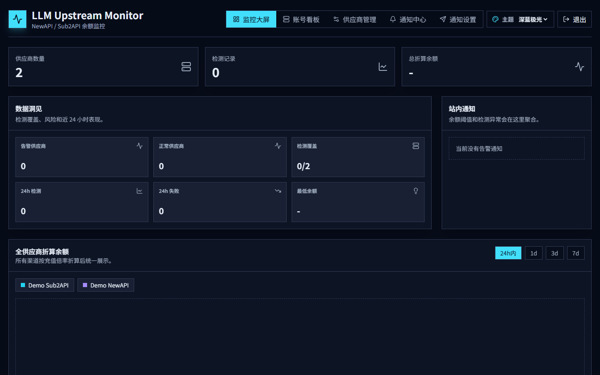
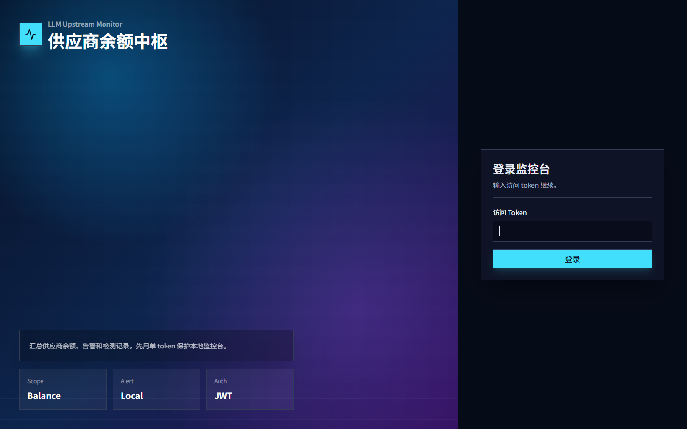
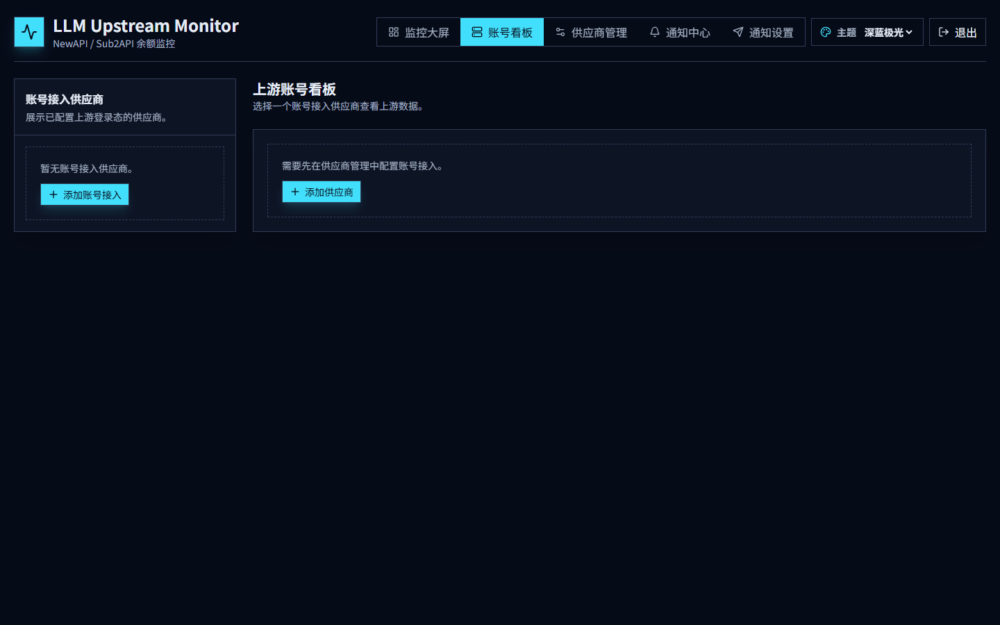
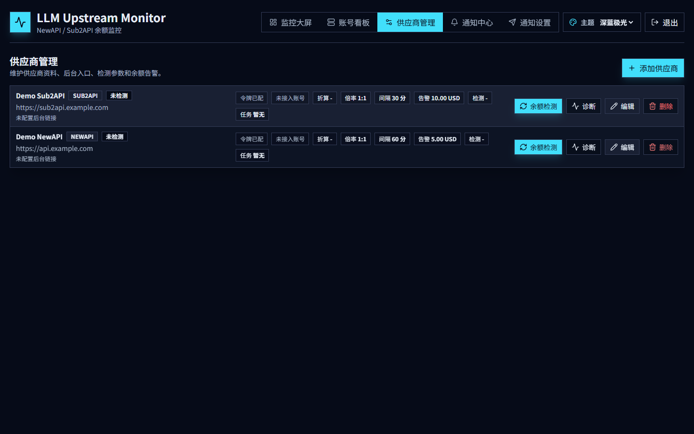
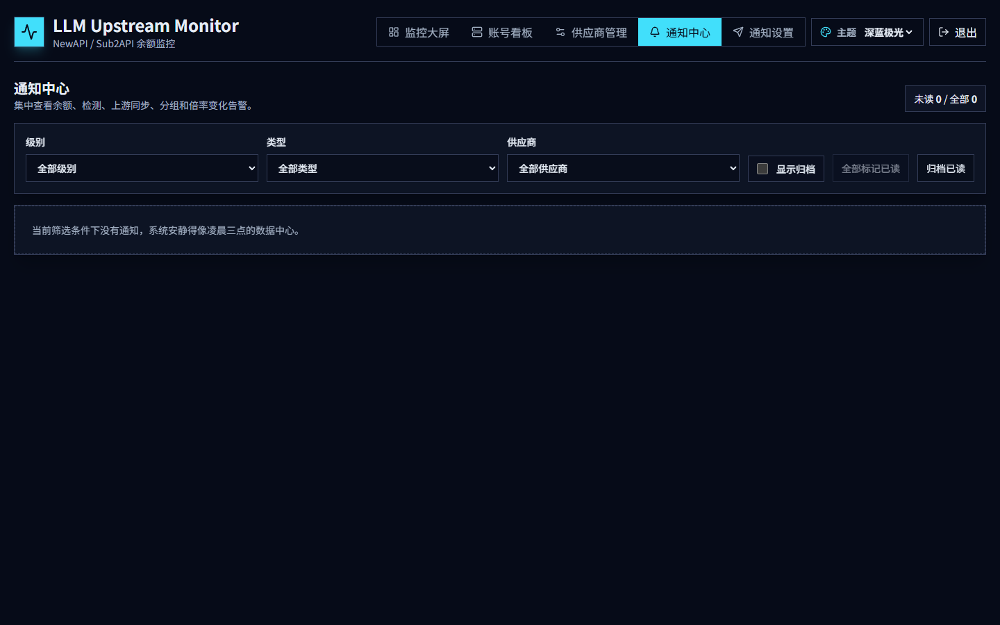
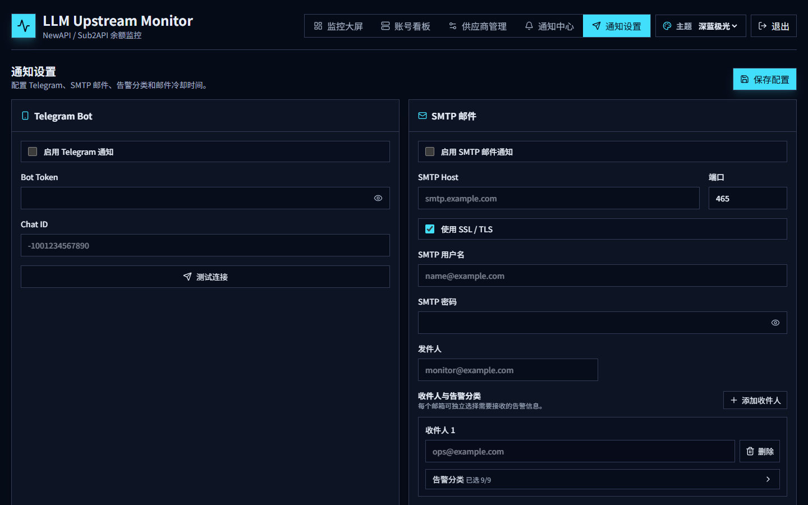
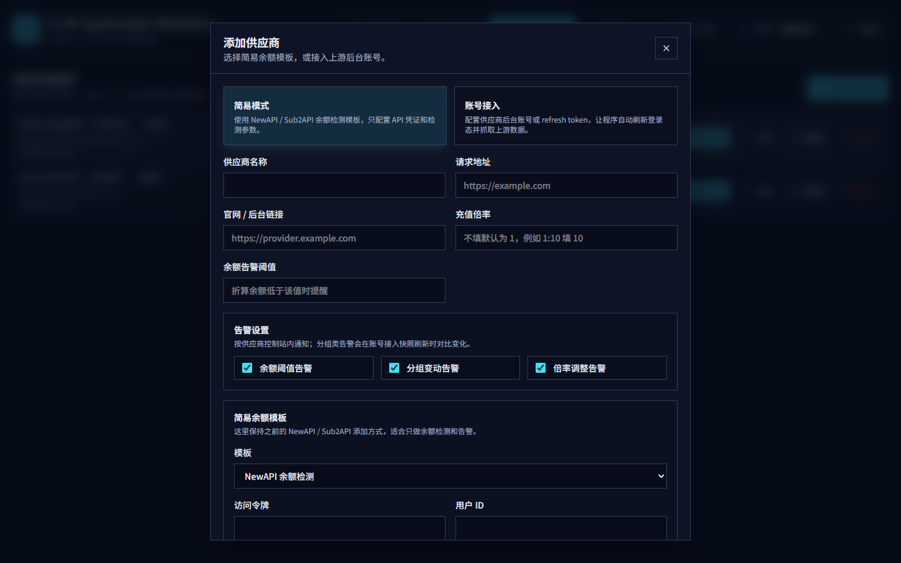

# LLM Upstream Monitor

[](./LICENSE)
[](https://www.typescriptlang.org/)
[](https://nodejs.org/)
[](https://www.electronjs.org/)
[](https://github.com/Kazi6de1b/LLM-Upstream-Monitor/releases)

本地优先的 **上游 AI / LLM Gateway 余额监控工具**。

支持 NewAPI 与 Sub2API 风格网关：自动轮询余额、可视化趋势、余额 / 分组变更告警，并提供 Web 与 **Windows 便携桌面端**。

<p align="center">
  
</p>

---

## 功能特性

| 模块 | 能力 |
| --- | --- |
| **供应商管理** | 添加 / 编辑 / 删除渠道，支持 NewAPI、Sub2API 模板 |
| **余额检测** | 手动检测 + 按渠道配置间隔自动轮询，失败写入错误信息 |
| **监控大屏** | 余额趋势图表、多渠道总览、风险与覆盖洞察 |
| **账号看板** | 上游账号快照同步（用量、分组、费率等） |
| **通知中心** | 站内通知；Telegram Bot / SMTP 邮件外发 |
| **告警策略** | 余额阈值、分组变更、分组费率变更告警开关 |
| **安全** | Token / API Key 后端存储，前端仅展示脱敏状态 |
| **桌面端** | Electron 便携版，一键启动本地 API + Web |

### 渠道模板

<details>
<summary><strong>NewAPI</strong></summary>

- 请求：`GET {{requestUrl}}/api/user/self`
- 鉴权：Access Token + User ID
- 余额换算：`quota / 500000` → USD（与常见 NewAPI 约定一致）
</details>

<details>
<summary><strong>Sub2API</strong></summary>

- 请求：`GET {{requestUrl}}/v1/usage`
- 鉴权：API Key
- 可选上游登录态，用于账号看板同步
</details>

---

## 界面预览

| 登录 | 监控大屏 |
| --- | --- |
|  |  |

| 账号看板 | 供应商管理 |
| --- | --- |
|  |  |

| 通知中心 | 通知设置 |
| --- | --- |
|  |  |

<p align="center">
  
  <br />
  <sub>添加供应商：简易余额模板 / 上游账号接入</sub>
</p>

---

## 快速开始

### 环境要求

- **Node.js** 18+（推荐 20 LTS）
- **npm** 9+
- Windows 构建桌面端时使用 electron-builder（已包含在 devDependencies）

### 1. Web + API（开发）

```bash
git clone https://github.com/Kazi6de1b/LLM-Upstream-Monitor.git
cd LLM-Upstream-Monitor
cp .env.example .env          # Windows: copy .env.example .env
npm install
npm run dev
```

| 服务 | 地址 |
| --- | --- |
| Web UI | http://localhost:5300 |
| API | http://localhost:3000 |
| 健康检查 | http://localhost:3000/health |

### 默认登录

| 项目 | 值 |
| --- | --- |
| **默认访问 Token / 登录密码** | `llm-monitor` |

- Web / 便携版登录页输入上述 Token 即可进入。
- 未设置环境变量时，API 也使用该默认值（便于开箱即用）。
- 可通过 `AUTH_TOKEN` 覆盖；**暴露到公网或共享机器时务必改成强随机字符串**。

### 2. 桌面端开发

```bash
npm run desktop:dev
```

会构建 shared / API，再启动 Vite 与 Electron。

### 3. Windows 便携版

```bash
npm run desktop:build
```

产物：

```text
release/LLM-Upstream-Monitor-<version>-portable.exe
```

双击运行后，在登录页输入默认 Token：

```text
llm-monitor
```

便携版数据默认写在可执行文件同级：

```text
data/llm-upstream-monitor.db
```

也可指定数据目录：

```powershell
$env:LLM_UPSTREAM_MONITOR_DATA_DIR = "D:\llm-monitor-data"
.\LLM-Upstream-Monitor-0.1.0-portable.exe
```

> **体积说明**：当前便携版约 **~80MB**（Electron/Chromium 占主体）。打包已启用最大压缩、仅保留 `en-US`/`zh-CN` 语言包，并剔除测试文件、文档与多余运行时文件。

---

## 添加供应商

### 简易模式

只需 NewAPI / Sub2API 的 API 凭证，适合只做余额检测与告警。

### 账号接入模式（Sub2API 后台 + Refresh Token）

用于拉取上游账号看板（用量、分组、费率等）。程序会用 **Refresh Token** 调用上游 `/auth/refresh` 刷新登录态，再抓取后台数据。

当上游站点启用了 **Cloudflare / 人机验证** 时，本工具往往无法直接用账号密码完成网页登录。推荐流程：

1. 在 **浏览器** 中打开上游供应商后台，手动完成登录（包括 Cloudflare 验证码）。
2. 登录成功后，打开开发者工具：
   - Chrome / Edge：`F12` → **Application（应用程序）** → **Local Storage**
   - 或 **Application** → **Session Storage**（部分站点存这里）
3. 在对应上游域名下查找类似键名：
   - `refresh_token`
   - `refreshToken`
   - 或嵌套在 JSON 对象里的 `refresh_token` 字段  
     （常见于 Sub2API 风格前端；不同站点键名可能略有差异，可搜索 `refresh`）
4. 复制该 **Refresh Token** 字符串。
5. 回到本应用 → **供应商管理** → **添加供应商** → 选择 **账号接入**：
   - 填写 **请求地址**（上游站点根 URL，如 `https://your-provider.example`）
   - 填写 **Sub2API API Key**（余额检测用）
   - 将复制的值粘贴到 **Refresh token** 字段
   - 可选：填写 Access token、Token 过期时间；若只填 Refresh token，程序会在需要时自动刷新
6. 保存后，可在 **账号看板** 手动同步，或等待定时任务拉取快照。

**提示：**

- Refresh Token 属于敏感凭证，勿截图公开、勿提交到 Git。
- Token 失效后（登出、过期、被吊销），需重新按上述步骤从浏览器取出并更新。
- 若站点同时开启 2FA 且无法导出 refresh token，账号接入可能不可用，请改用简易模式做余额检测。

---

## 配置

复制 [`.env.example`](./.env.example) 为 `.env`：

| 变量 | 默认值 | 说明 |
| --- | --- | --- |
| `API_HOST` | `0.0.0.0` | API 监听地址 |
| `API_PORT` | `3000` | API 端口 |
| `DATABASE_URL` | `file:./data/llm-upstream-monitor.db` | SQLite（libSQL）路径 |
| `AUTH_TOKEN` | `llm-monitor` | 登录密码 / API Bearer Token |

前端可选：

| 变量 | 说明 |
| --- | --- |
| `VITE_API_BASE_URL` | 覆盖默认 API 地址 |

也可在 URL 使用：`?apiBaseUrl=http://127.0.0.1:3000`。

---

## 项目结构

```text
LLM-Upstream-Monitor/
├── apps/
│   ├── api/          # Fastify API、定时任务、SQLite、通知发送
│   ├── web/          # React + Vite 监控界面
│   └── desktop/      # Electron 主进程与打包配置
├── packages/
│   └── shared/       # 前后端共享 TypeScript 类型
├── docs/
│   ├── images/       # README 截图
│   └── DEVELOPMENT_PLAN.md
├── apps/desktop/after-pack.cjs  # 桌面打包后瘦身
├── scripts/
│   └── capture-screenshots.mjs  # 可选：界面截图脚本
├── .env.example
└── package.json
```

### 架构

```text
┌─────────────────┐     HTTP/JSON      ┌──────────────────────┐
│  Web (React)    │ ◄────────────────► │  API (Fastify)       │
│  Electron UI    │                    │  + node-cron         │
└─────────────────┘                    │  + libSQL (SQLite)   │
                                       └──────────┬───────────┘
                                                  │
                    ┌─────────────────────────────┼─────────────────────────────┐
                    ▼                             ▼                             ▼
             NewAPI / Sub2API              Telegram / SMTP                本地 SQLite
              余额 / 上游同步                  告警通知                     历史与配置
```

---

## 常用脚本

| 命令 | 说明 |
| --- | --- |
| `npm run dev` | 并行启动 API + Web |
| `npm run desktop:dev` | Electron 开发模式 |
| `npm run desktop:build` | 构建 Windows 便携 exe |
| `npm run build` | 构建全部 workspace |
| `npm run typecheck` | 全量 TypeScript 检查 |
| `npm test` | Vitest 单元 / 路由测试 |
| `npm run lint` | ESLint |
| `npm run format` | Prettier 格式化 |

---

## 技术栈

| 层级 | 选型 |
| --- | --- |
| 前端 | React 19、Vite、TypeScript、Tailwind CSS 4、Recharts |
| 后端 | Node.js、Fastify、Zod、node-cron、Nodemailer |
| 数据 | SQLite via `@libsql/client` |
| 桌面 | Electron、electron-builder（portable） |
| 工程 | npm workspaces、Vitest、ESLint、Prettier |

---

## API 概览

除 `/health` 与登录外，均需：

```http
Authorization: Bearer <AUTH_TOKEN>
```

| 方法 | 路径 | 说明 |
| --- | --- | --- |
| `POST` | `/api/auth/login` | 登录 `{ "password": "..." }` |
| `GET` / `POST` | `/api/channels` | 列出 / 创建渠道 |
| `GET` / `PATCH` / `DELETE` | `/api/channels/:id` | 查询 / 更新 / 删除 |
| `POST` | `/api/channels/:id/check` | 手动余额检测 |
| `GET` | `/api/channels/:id/checks` | 检测历史 |
| `POST` | `/api/channels/:id/sync-upstream` | 同步上游快照 |
| `GET` | `/api/upstream-accounts/snapshots` | 上游快照列表 |
| `GET` | `/api/notifications` | 通知列表 |
| `GET` / `PUT` | `/api/notification-settings` | 通知配置 |
| `POST` | `/api/notification-settings/test` | 发送测试通知 |
| `GET` | `/health` | 健康检查 |

第一版功能基准见 [docs/DEVELOPMENT_PLAN.md](./docs/DEVELOPMENT_PLAN.md)（当前实现已超出该文档范围）。

---

## 安全说明

- 默认登录 Token 为 `llm-monitor`，仅适合 **本机 / 受信网络** 开箱使用；对外部署请通过 `AUTH_TOKEN` 修改。
- 供应商 Token / API Key / Refresh Token **不会在列表接口中明文返回**，前端只看到 `hasAccessToken` / `hasApiKey` 等状态位。
- 查询逻辑由后端内置模板实现，**不会执行用户任意脚本**。
- 若暴露到公网，请务必：
  1. 修改默认 `AUTH_TOKEN`
  2. 使用 HTTPS 反向代理
  3. 限制访问来源（防火墙 / VPN）
- 数据库含密钥与历史，请控制文件权限并定期备份。

---

## 桌面端体积优化（已启用）

| 策略 | 效果 |
| --- | --- |
| `compression: maximum` | 便携包最大压缩 |
| `electronLanguages: en-US, zh-CN` | 语言包从 ~55 个减到 2 个（约减 45MB 解压体积） |
| 排除 `*.test.*` / `*.map` / 文档与 benchmark | asar 从 ~18MB 降到 ~8MB |
| `after-pack` 删除 Chromium 许可证 HTML 与 SwiftShader | 再减约 25MB 解压体积 |
| `npmRebuild: false` | 跳过不必要的原生重建 |

Electron 本体（Chromium）仍是体积主体，进一步压缩需评估更激进方案（如更轻运行时），会牺牲兼容性。

---

## 开发与贡献

欢迎 Issue 与 Pull Request。

```bash
git checkout -b feature/your-feature
npm install
npm run typecheck
npm test
```

建议方向：

- 更多上游网关模板
- Linux / macOS 桌面构建
- 国际化（i18n）
- 更细粒度权限 / 多用户
- 应用图标与品牌资源

可选：重新截取界面图（需本机 Chrome + 已启动 `npm run dev`）：

```bash
npm install --no-save puppeteer-core
node scripts/capture-screenshots.mjs
```

---

## 路线图

- [x] NewAPI / Sub2API 余额监控
- [x] 图表与检测历史
- [x] 通知（站内 + Telegram + SMTP）
- [x] 上游账号看板
- [x] 渠道删除与上游会话清理
- [x] Windows Electron 便携版 + 体积优化
- [x] 开源文档与界面截图
- [ ] 官方 Release 自动构建（GitHub Actions）
- [ ] 更多网关适配器
- [ ] 跨平台桌面发行

---

## 致谢

- [NewAPI](https://github.com/QuantumNous/new-api) 及兼容网关生态
- [Fastify](https://fastify.dev/)、[Vite](https://vite.dev/)、[Electron](https://www.electronjs.org/) 等开源项目

---

## License

[MIT License](./LICENSE) © 2026 Kazi6de1b

如果这个项目对你有帮助，欢迎 ⭐ Star，也欢迎把使用场景和改进建议开在 Issue 里。
